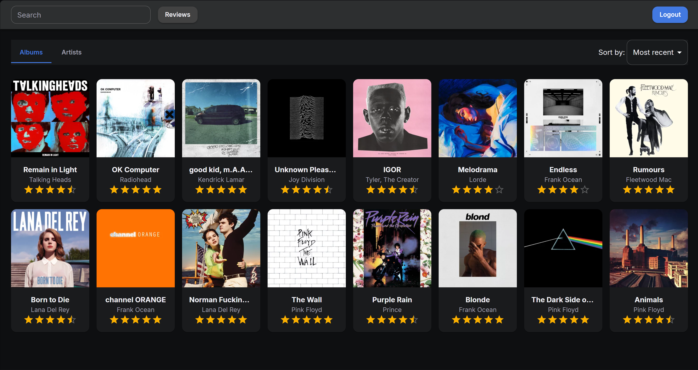

# Side C

Side C is a music review application for searching, rating and reviewing albums and artists.

Users can create an account, search for music, add ratings and written reviews, and manage their own reviews.



## Live Demo

Demo account:

Username: demo
<br>
Password: 12345678

https://side-c-music-review.onrender.com


## Features

- Search for albums and artists
- Rate albums and artists out of 10
- Write, edit and delete reviews
- Sort reviews by rating, date and alphabetically
- User registration and login
- Album and artist metadata from Last.fm
- Artwork from Fanart.tv


## Tech Stack

### Frontend
- React
- TypeScript


### Backend
- Java
- Spring Boot
- Spring Security
- Spring Data JPA
- PostgreSQL


### Testing
- JUnit
- Mockito
- MockMvc

## Running Locally

Requirements:

- Java 21
- Node.js
- PostgreSQL


### Backend

Set the required environment variables:

- `DB_URL`
- `DB_USERNAME`
- `DB_PASSWORD`
- `LASTFM_API_KEY`
- `FANART_API_KEY`
- `FRONTEND_URL`

Then from the backend directory run:

```bash
./mvnw spring-boot:run
```

### Frontend

Rename `.env.example` to `.env` and set `VITE_API_BASE_URL` to point to your backend
<br>
<br>
Then from the frontend directory run:

```bash
npm install
npm run dev
```

## License

This project is licensed under the MIT License. See [LICENSE](LICENSE).


